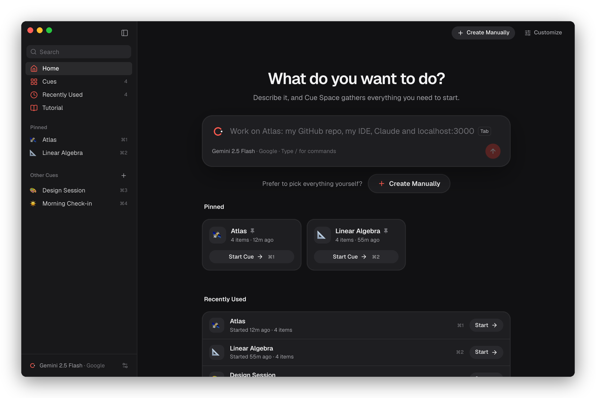
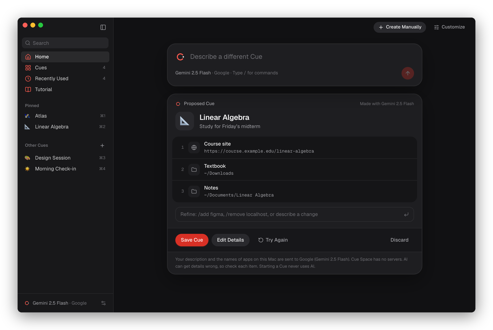
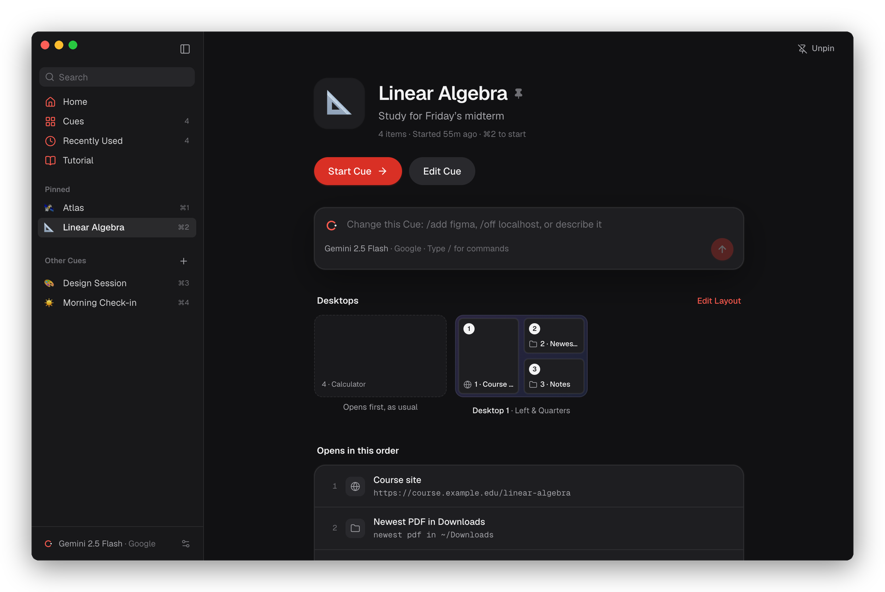
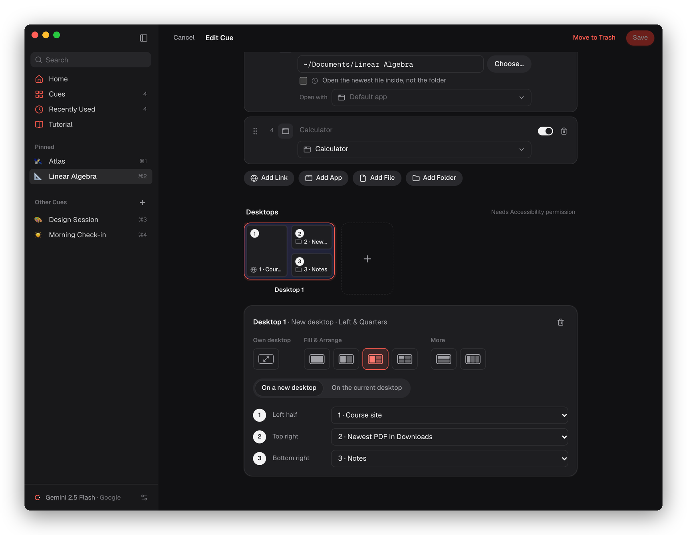
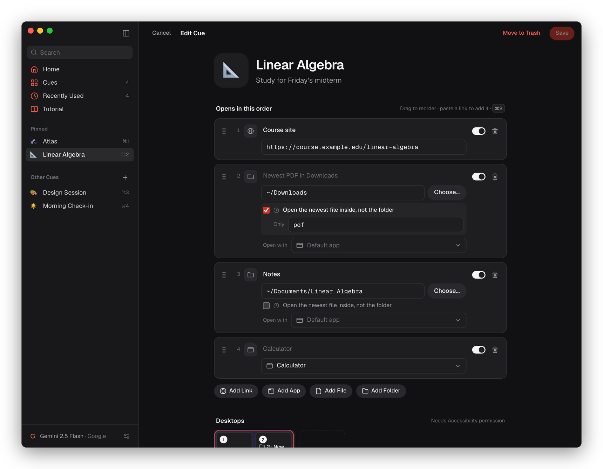
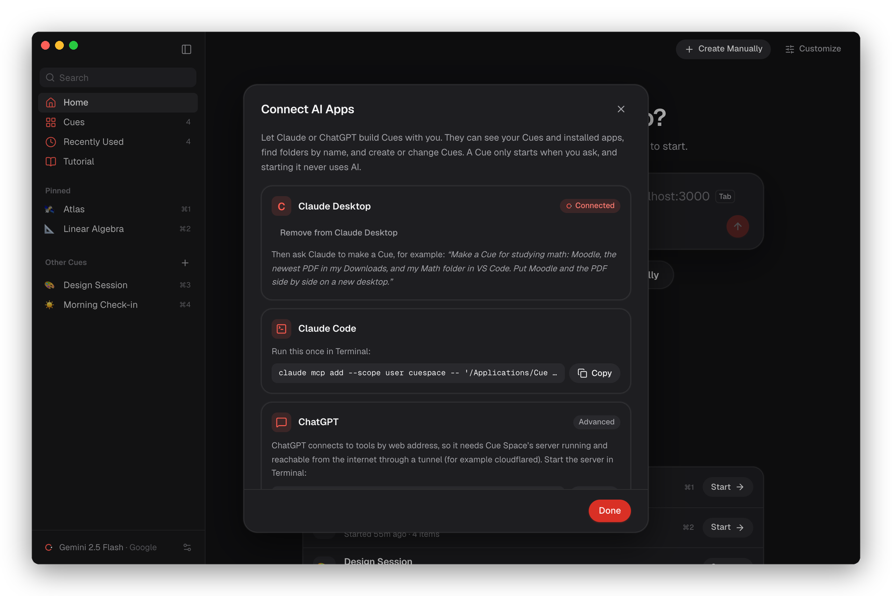
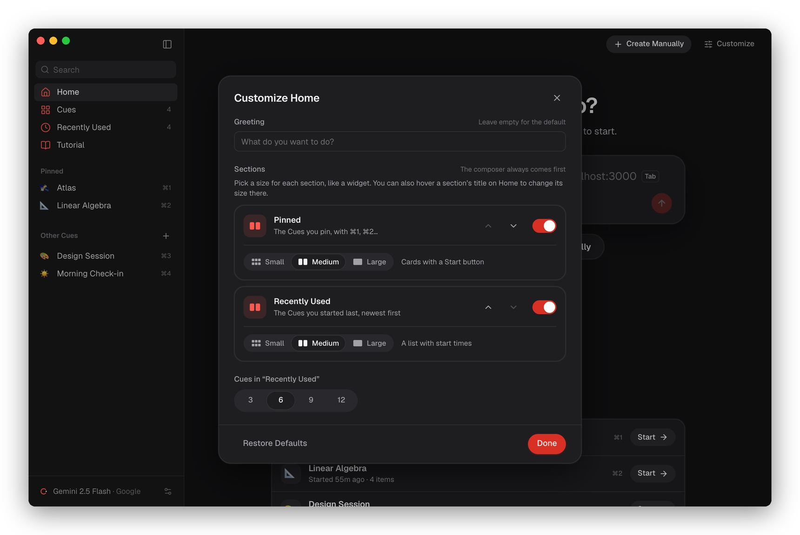
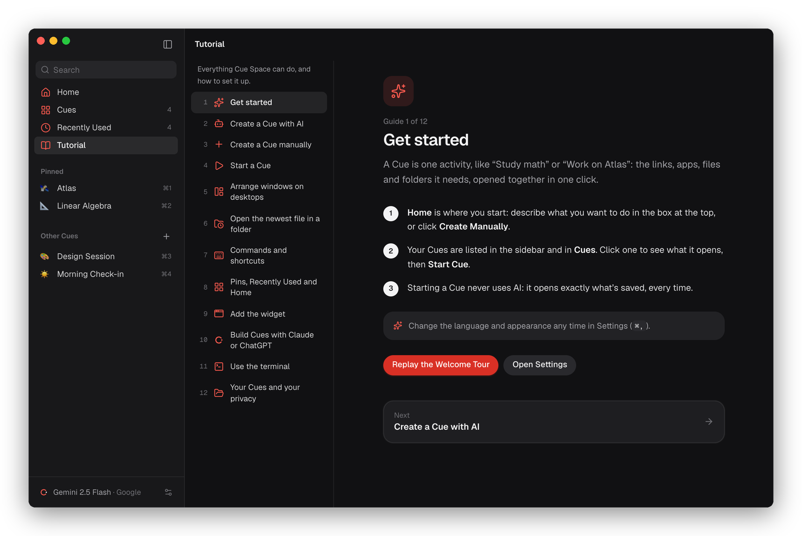
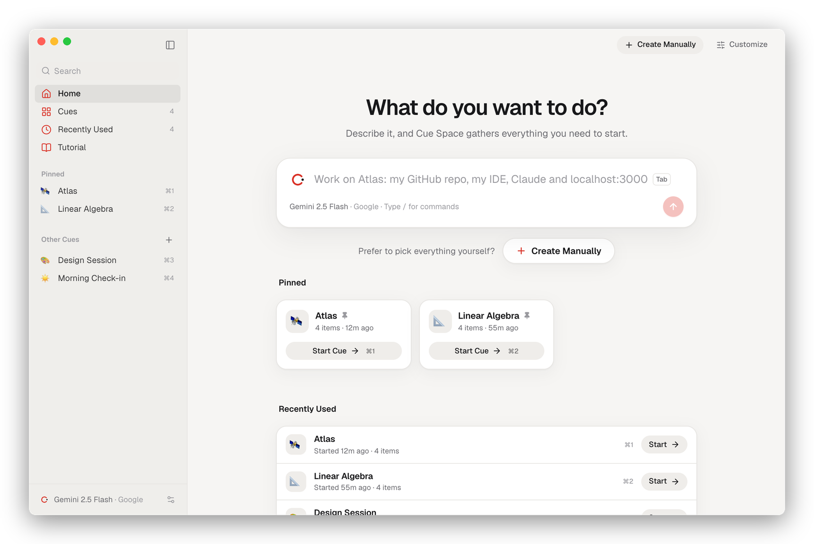

<p align="center">
  
</p>

<h1 align="center">Cue Space</h1>

<p align="center">
  <b>Your Mac thinks in apps. You think in activities.</b><br>
  One click opens everything an activity needs: links, apps, files and folders, arranged across your desktops.
</p>

<p align="center">
  <a href="https://github.com/ShehabEddin64/Cue_Space/releases/latest/download/CueSpace.dmg"><b>Download for Mac</b></a>
  ·
  <a href="https://shehabeddin64.github.io/Cue_Space/">Website</a>
  ·
  <a href="docs/guide.md">Guide</a>
</p>

<p align="center">
  <sub>macOS 12 or later · Apple silicon and Intel · Signed and notarized · Free and open source</sub>
</p>

https://github.com/user-attachments/assets/aee529f5-3319-4f4e-8394-fd31b428f28d


## What is a Cue?

A Cue is a saved activity, like *“Study linear algebra”* or *“Work on Atlas”*: the links, apps, files and folders it needs. Start it and everything opens, in order, arranged the way you like.

```
🛰️ Atlas                        📐 Linear Algebra
   GitHub                           Course site
   Code in VS Code                  Newest PDF in Downloads
   Claude                           Notes
   localhost:3000                   Calculator
   Start Cue →                      Start Cue →
```



## Features

### Describe it, or build it

Tell Cue Space what you want to do and your own AI proposes the Cue, using apps you actually have. Review it, fix anything, save. Prefer doing it yourself? **Create Manually** builds one by hand: AI is never required.



### One click, arranged across your desktops

Start a Cue from its page, the sidebar, **⌘1–⌘9**, the menu bar or the desktop widget. Windows can go full screen on their own desktop, side by side on a new desktop, in quarters or thirds, with a Mission Control-style preview.

<p>
  
  
</p>

### The details that save time

- **Newest file in a folder:** open your latest download or scan, optionally only PDFs.
- **Slash commands:** `/add figma, ~/Notes`, `/off localhost`, `/start atlas`. Most run on your Mac with no AI at all.
- **Tab to complete:** the composer suggests ideas; press Tab to use one.



### Build Cues with Claude or ChatGPT

Cue Space includes an MCP server and a command-line tool. Connect Claude Desktop in one click, then just ask: *“Make me a Cue for my morning: Mail, Calendar and Notion.”*



### Make it yours

Pin favorites, see what you used recently, resize Home’s sections like widgets, switch between light and dark, and use the app in **English or French**. A built-in **Tutorial** explains every feature and how to set it up.

<p>
  
  
</p>
<p>
  
  
</p>

## Install

1. [Download **CueSpace.dmg**](https://github.com/ShehabEddin64/Cue_Space/releases/latest/download/CueSpace.dmg).
2. Open it and drag **Cue Space** to **Applications**.
3. Optional: to describe Cues, add an AI in Settings (⌘,). Gemini has a free tier.
4. Optional: to arrange windows, allow Cue Space in **System Settings › Privacy & Security › Accessibility**.

## Private by design

- **Local first:** no account and no cloud. Your Cues are plain JSON files on your Mac.
- **Bring your own AI:** Gemini, Anthropic, any OpenAI-compatible server, or a local model. Keys stay in the macOS Keychain.
- **AI creates, Cue Space executes:** starting a Cue never uses AI. It opens exactly what’s saved, every time, offline.

## Tech stack

| | |
| --- | --- |
| App | [Go](https://go.dev) with [Wails v3](https://v3.wails.io) (native macOS app with a web view) |
| Interface | [React](https://react.dev), [TypeScript](https://www.typescriptlang.org), [Vite](https://vite.dev), [Tailwind CSS](https://tailwindcss.com) |
| macOS | Accessibility and Mission Control APIs for layouts, a [WidgetKit](https://developer.apple.com/widgets/) widget in Swift |
| AI | [Anthropic Go SDK](https://github.com/anthropics/anthropic-sdk-go), Gemini API, OpenAI-compatible APIs |
| Integrations | [MCP Go SDK](https://github.com/modelcontextprotocol/go-sdk) for Claude and ChatGPT, `cuespace-cli` |
| Release | Developer ID signing, notarization and a GitHub Actions release workflow |

## Built with

**Libraries:**
- [dnd-kit](https://dndkit.com) for drag and drop
- [Lucide](https://lucide.dev) icons
- [Geist](https://vercel.com/font) by Vercel, via [Fontsource](https://fontsource.org)
- [jsonschema](https://github.com/santhosh-tekuri/jsonschema), [fsnotify](https://github.com/fsnotify/fsnotify), [go-keyring](https://github.com/zalando/go-keyring) and [plist](https://github.com/DHowett/go-plist)

**Built with [Claude Code](https://claude.com/claude-code), and these skills:**
- [apple-design](https://github.com/dickwu/apple-design-skill): Apple Human Interface Guidelines reviews for the design
- [/brag](https://github.com/latent-spaces/brag): the demo video above, rendered with [puppeteer](https://pptr.dev) and [FFmpeg](https://ffmpeg.org)
- claude-api (bundled with Claude Code): the Anthropic SDK integration

## Development

```bash
go install github.com/wailsapp/wails/v3/cmd/wails3@v3.0.0-beta.28
wails3 dev              # run with hot reload
./scripts/build.sh      # build and open bin/cuespace.app
```

More in [docs/development.md](docs/development.md), releases in [docs/releasing.md](docs/releasing.md), and contributing in [CONTRIBUTING.md](CONTRIBUTING.md).

## License

[MIT](LICENSE)
